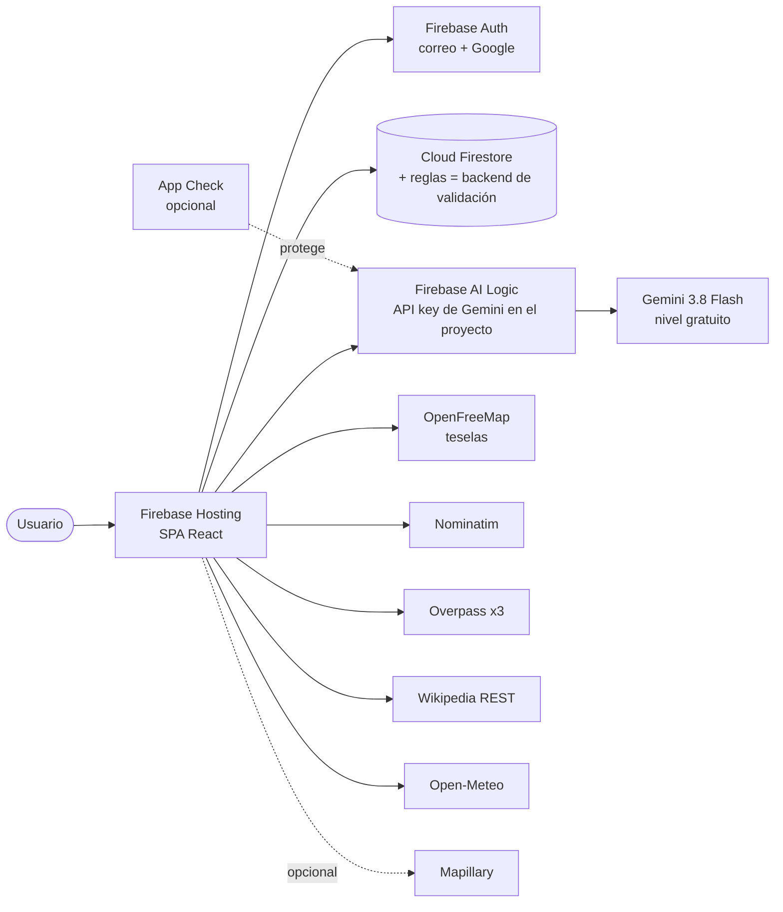
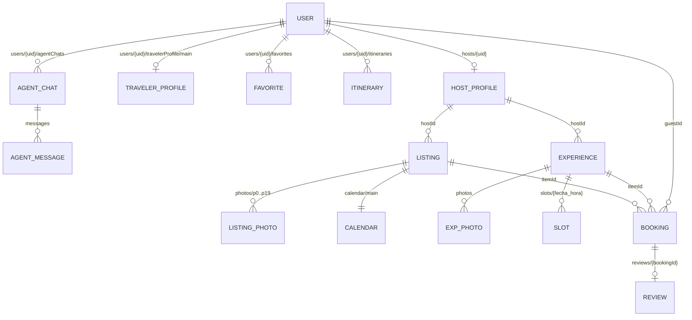

# Arquitectura de LOCUS (versión 2)

> Actualiza `docs/analysis/01_ARQUITECTURA_TECNICA.md` (que describe el prototipo anterior).
> Lo que no cambió (React + Vite + Tailwind, tokens de diseño, motor de itinerarios) no se repite.

## 1. Visión general

LOCUS sigue siendo una **SPA en React** publicada en **Firebase Hosting**, ahora con cuentas, catálogo
propio, reservas, modo anfitrión y un agente de IA. **No hay servidor propio**: se eligió el plan
**Spark (sin costo ni facturación)**, así que la lógica sensible vive en las **reglas de Firestore**
(que actúan como backend de validación) y la IA se consume a través de **Firebase AI Logic**.

Dos modos de ejecutarlo:

| Modo | Backend real | Comando |
|---|---|---|
| **Desarrollo local** | **Emuladores** de Auth y Firestore (nada toca producción); la IA y los servicios abiertos sí son reales | `npm run dev` |
| Producción | Proyecto `locus-bb57e` | `npm run deploy` (o merge a `main` con CI) |

## 2. Módulos

| Módulo | Ubicación | Responsabilidad |
|---|---|---|
| Autenticación y usuarios | `src/lib/auth/` | Registro/ingreso (correo y Google), perfil `users/{uid}`, rol anfitrión, administrador. |
| Perfil del viajero | `src/lib/profile/`, `components/agent/SurveyChat.tsx` | Encuesta conversacional, perfil declarado vs. inferido, recomendaciones por reglas, favoritos. |
| Agente de IA | `src/lib/agent/`, `components/agent/` | Gemini + herramientas, widget flotante, historial, tope de uso. |
| Catálogo (alojamientos/experiencias) | `src/lib/catalog/` | Lectura pública, publicación, fotos, calendario, reseñas, alojamientos OSM de referencia. |
| Reservas | `src/lib/booking/`, `src/lib/domain/pricing.ts` | Tarifas, transacciones, cancelaciones, calendario. |
| Anfitrión | `src/pages/host/` | Panel, formularios, calendario, reservas recibidas. |
| Administración | `src/pages/AdminPage.tsx` | Moderación (aprobar/rechazar/suspender). |
| Mapas | `src/lib/maps/` | `LocusMap` (MapLibre + OpenFreeMap), selector de ubicación. |
| Clima | `src/lib/weather/` | Open-Meteo con caché. |
| Vuelos | `src/lib/flights/` | Aeropuertos y enlaces de búsqueda. |
| Itinerarios | `src/lib/itinerary/` | Motor (OSM), guardado y edición. |
| Dominio | `src/lib/domain/` | Tipos, fechas, tarifas, validaciones (puros y probados). |

## 3. Navegación (React Router)

`/` portada + Paso 1 · `/planear` pasos 2–4 · `/explorar` hospedajes (lista+mapa) · `/hospedajes/:id` ·
`/experiencias` · `/experiencias/:id` · `/destinos/:id` · `/vuelos` · `/itinerarios[/:id]` ·
`/favoritos` · `/reservas` · `/perfil` · `/bienvenida` (encuesta) · `/ingresar` ·
`/anfitrion` (panel, `alojamientos/nuevo|:id[/calendario]`, `experiencias/nueva|:id`, `reservas`) · `/admin`.
Las pantallas se cargan de forma perezosa. Firebase Hosting reescribe `**` → `index.html`.

## 4. Modelo de datos (Firestore)

| Colección | Contenido clave | Quién lee | Quién escribe |
|---|---|---|---|
| `users/{uid}` | nombre, teléfono, `isHost`, consentimiento IA, onboarding | dueño | dueño |
| `users/{uid}/travelerProfile/main` | `declared{…}`, `inferred{…}`, `version`, `completedAt`, `updatedAt` | dueño | dueño (la IA solo toca `inferred`, visible para el usuario) |
| `users/{uid}/favorites`, `itineraries`, `agentChats/*/messages`, `agentUsage/{día}` | — | dueño | dueño (`agentUsage` ≤ 60/día) |
| `hosts/{uid}` | nombre público, bio, RNT, `verified` | **público** | dueño (`verified` solo admin) |
| `listings/{id}` | ficha completa, `status`, precio, política, `cover` (miniatura) | publicados: **todos**; borrador/revisión: dueño y admin | dueño crea/edita; **solo admin publica/rechaza/suspende** |
| `listings/{id}/photos/p0..p19` | `dataUrl` WebP (≤450.000 car.) | como la ficha | dueño |
| `listings/{id}/calendar/main` | `booked{fecha:'booking'}`, `hostBlocked{fecha:'host'}`, `lastBookingId` | **público** (disponibilidad) | ver §5 |
| `experiences/{id}` (+`photos`, `slots`) | ídem; `slots/{AAAA-MM-DD_HHMM}.booked` | ídem | ídem |
| `bookings/{id}` | tipo, ítem, fechas/noches o sesión, `pricing{…}`, `status`, `payment` | huésped, anfitrión, admin | creación por el huésped (validada); cambios de estado por las partes |
| `reviews/{bookingId}` | calificación 1–5, texto | **público** | el huésped, solo de una reserva `completed` |
| `admins/{uid}` | existencia = es administrador | el propio uid | **solo consola** |
| `itineraries/{id}` (heredada) | prototipo anterior | dueño | se conserva para no perder datos |

**Procedencia de la información** (nunca se mezcla en una misma tarjeta):
- *Catálogo propio de LOCUS* → `listings`/`experiences` (reservables).
- *Fuentes abiertas* → OSM/Wikipedia, mostradas aparte, con atribución y marcadas "no reservable".
- *Contenido editorial* → destinos destacados (`featuredDestinations.ts`, `recommend.ts`).
- *Externos autorizados con reserva* → **ninguno** (no existe API gratuita; ver PROVEEDORES.md).

**Fotos:** sin Cloud Storage (exige plan Blaze), se comprimen en el navegador y se guardan como data URL
WebP en Firestore (galería ≤ ~330 kB; miniatura ≤ ~60 kB en la ficha). Las reglas validan formato y tamaño.
Migrar a Storage/CDN es un cambio localizado en `catalog/repo.ts` (`replacePhotos`).

**Índices:** no hacen falta compuestos: las consultas filtran por un solo campo y el resto se ordena/filtra en
el cliente (catálogo acotado a 120 documentos por consulta).

## 5. Reservas: cómo se evita el doble reservado sin servidor

El riesgo: dos huéspedes reservan las mismas noches a la vez, o alguien manipula el precio desde el navegador.
La solución combina **transacción en el cliente + reglas en el servidor** (las reglas son las que mandan):

1. El cliente abre una **transacción** de Firestore: lee `calendar/main`, verifica que las noches estén libres
   y, en un solo lote atómico, **crea la reserva y marca las noches** (`booked`). Firestore reintenta si hubo contención.
2. Las **reglas** validan ese mismo lote con `getAfter()`:
   - La reserva exige que el calendario **se actualice en el mismo lote** (`lastBookingId == id`) y que el precio
     coincida con el del alojamiento (`pricePerNight × noches + limpieza + extras`, mismas fórmulas que
     `domain/pricing.ts`), que las fechas no estén en el pasado, `guests ≤ capacidad`, `noches ∈ [mín, máx]`, el huésped
     sea quien escribe y **no sea el anfitrión**.
   - El calendario solo acepta **agregar** exactamente las noches de esa reserva, **nunca pisar** noches ocupadas ni quitar
     las de otro, y nunca tocar `hostBlocked`.
   - La cancelación debe **liberar exactamente** las noches de esa reserva en el mismo lote; sin eso, se rechaza.
3. Experiencias: el contador `slots/{fecha_hora}.booked` solo puede subir en `+personas` de la reserva y nunca superar la capacidad.

Probado con el emulador (`tests/rules`, 42 pruebas): reservas concurrentes del mismo rango (gana una), intentos de
pisar noches ajenas, precios manipulados, reservas sin calendario, cupos excedidos, cancelaciones ajenas, etc.

**Límites conocidos (honestos):**
- Las reglas no pueden verificar que las noches sean *consecutivas* (un huésped malintencionado podría reservar noches
  sueltas pagando el mismo precio por noche: solo se perjudica a sí mismo).
- Un huésped podría bloquear muchas fechas sin pagar: con pagos **simulados** no hay cobro que lo impida. Con pagos reales,
  la reserva debe quedar "pendiente de pago" hasta el webhook (requiere backend).
- Los reembolsos son **informativos** (`refundAmount` lo escribe el cliente) hasta que existan pagos reales.
- Las reglas limitan ~20 operaciones de acceso por lote: por eso el calendario es **un documento por alojamiento** (mapa de noches).

## 6. Roles y autorización

Un usuario es **huésped** siempre y **anfitrión** si creó su `hosts/{uid}`. Una sola cuenta, sin duplicados. El **administrador**
es quien tiene `admins/{uid}` (creado a mano en la consola). Las reglas, no la interfaz, deciden: un anfitrión **no puede
auto-publicar**; un tercero no lee reservas ajenas; nadie edita el perfil de otro.

Moderación: `draft → pending → published | rejected → (draft|pending)`; `suspended` lo pone el admin y el dueño no lo cambia.

## 7. Agente de IA

- **Acceso:** `firebase/ai` (`GoogleAIBackend`) → la API key de Gemini **nunca** está en el código. App Check opcional
  (`VITE_APPCHECK_SITE_KEY`). Modelo `gemini-3.8-flash` (`VITE_GEMINI_MODEL`).
- **Herramientas** (`lib/agent/tools.ts`, todas de **solo lectura** salvo `save_inference`): `search_listings`,
  `get_listing_details`, `search_experiences`, `get_destination_info`, `get_weather`, `find_places`, `plan_itinerary`,
  `recommend_destinations`, `flight_search_links`, `get_traveler_profile`, `save_inference`.
- **Anti-invención:** las herramientas devuelven datos reales *y* las **tarjetas** que ve el usuario (construidas por
  el código, no por el modelo); el prompt prohíbe inventar hospedajes, precios, horarios o tarifas y exige distinguir
  datos confirmados / fuentes abiertas / sugerencias.
- **Sin acciones sensibles:** no existe herramienta para reservar, pagar o editar cuenta; reservar siempre lo confirma el
  usuario en la ficha (diálogo de confirmación).
- **Perfil:** solo se resume en el prompt si el usuario dio su **consentimiento**; el agente no recibe nombre ni correo. Lo que
  el agente deduce se guarda aparte (`inferred`), con aviso en el chat, visible y borrable en *Mi perfil*; **nunca** modifica `declared`.
- **Control de costos:** 60 mensajes/día por usuario (12 por sesión sin cuenta), 4 rondas/8 herramientas por mensaje, historial
  recortado, caché de clima y de Overpass. El límite duro real es la cuota del proyecto (AI Studio) y el límite por usuario de Firebase AI Logic.
- **Degradación:** si la IA no está activada o se agotó la cuota, el widget lo explica y ofrece un **modo guiado** que ejecuta
  las herramientas sin modelo.
- **Seguridad frente a *prompt injection*:** los argumentos de herramientas se validan y acotan; el prompt ignora instrucciones
  incrustadas; los resultados externos (OSM) se muestran como texto, nunca como HTML.

## 8. Encuesta de preferencias

Conversacional, de una pregunta a la vez, **omitible** y **adaptativa** (`lib/profile/survey.ts`): 19–21 preguntas según las respuestas
(p. ej. edades de los niños solo si viajas con niños; deportes extremos solo si te interesan). Es **determinista** (sin IA): rápida,
gratuita y predecible. Se guarda en `travelerProfile/main.declared`, se puede **repetir desde *Mi perfil → Actualizar mis preferencias de viaje***
(precarga lo anterior) y alimenta `recommendDestinations()` (reglas explicables: "te lo sugerimos porque…").

## 9. Mapas y lugares

`LocusMap` = MapLibre GL JS + estilos `positron`/`dark` de OpenFreeMap (cambia con el tema). Marcadores con precio, selección
sincronizada tarjeta↔marcador↔vista previa, selector de ubicación (clic/arrastre + búsqueda Nominatim a demanda), "Cerca de mí" con la
geolocalización del navegador. Los lugares vienen de Overpass con **caché de 24 h** y reintentos entre 3 servidores; si fallan, para los **destinos destacados** se usa un
respaldo precalculado (`src/data/featuredPlaces.json`, generado con `npm run data:reference`) y para el resto se consulta **Nominatim** en vivo (`lib/itinerary/fallbackClient.ts` encadena Overpass → datos precalculados → Nominatim y avisa al usuario). Los **alojamientos de referencia** (`catalog/referenceLodging.ts`) salen de `referenceLodging.json` o de Nominatim, nunca de Overpass. **Riesgo:** Overpass es público y a veces no responde (ocurrió en las pruebas) → para producción seria conviene un
proxy con caché propio (decisión D1/D2 en `analysis/07`).

## 10. Pagos y notificaciones (pendientes de decisión)

Pagos **simulados** (ver `lib/booking/payments.ts` y PROVEEDORES §9). Notificaciones: hoy la interfaz muestra el estado de las reservas
(el anfitrión ve solicitudes en su panel); no hay correos ni notificaciones push (requieren backend).

## 11. Rendimiento

JS inicial ≈ 99 kB gzip (+ ~164 kB del SDK de Firebase compartido); MapLibre (~295 kB gzip) y el agente (~25 kB) se cargan **solo** cuando
se usan. Caché de assets con hash `immutable`. Imágenes del catálogo como miniaturas de ≤ ~60 kB.

## 12. Seguridad (resumen)

Reglas con denegación por defecto y 42 pruebas; validación de esquema y tamaño en el servidor; fotos validadas (formato/tamaño/ID);
sin secretos en el repositorio (la configuración web de Firebase es pública por diseño); cabeceras `nosniff`, `Referrer-Policy`,
`Permissions-Policy`; enlaces de OSM filtrados a http(s); redirecciones de login limitadas a rutas internas. **Pendientes:** CSP,
App Check en producción (requiere reCAPTCHA), política de privacidad/términos, verificación de correo.
