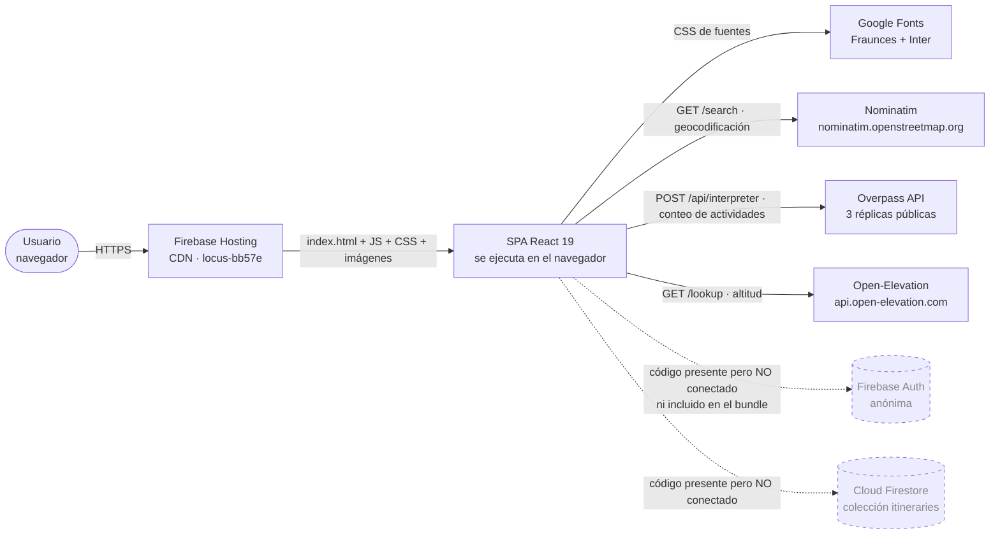
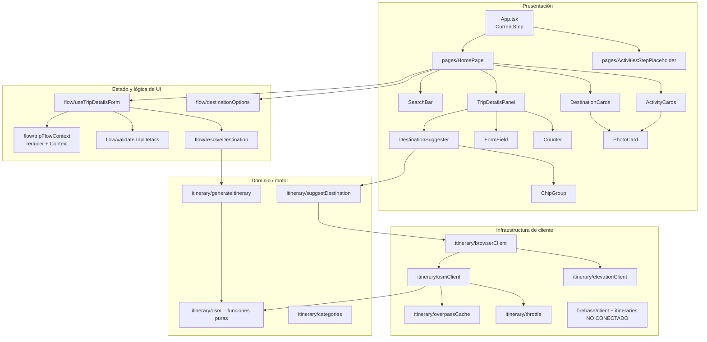
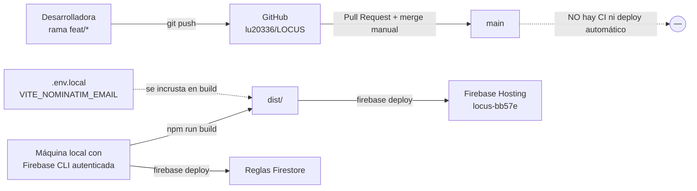

# 01 · Arquitectura técnica de LOCUS

> Análisis realizado el 2026-11-12 sobre la rama `main`, commit `a141668` (merge del PR #3).
> Todo lo que se afirma aquí está respaldado por archivos del repositorio, por la ejecución local
> (`npm ci`, `npm test`, `npm run lint`, `npm run build`, `vite preview`) o por consultas de **solo
> lectura** al sitio publicado. Lo que no pudo verificarse se marca como **No verificable**.

---

## 1. Resumen de la arquitectura

LOCUS es hoy una **SPA (Single Page Application) 100 % cliente**, escrita en React + TypeScript,
compilada con Vite y publicada como archivos estáticos en **Firebase Hosting**.

- **No tiene backend propio.** No hay servidor, API, Cloud Functions ni proxy.
- **Toda la lógica corre en el navegador**, incluido el "motor" de sugerencia de destinos, que habla
  **directamente** con servicios públicos de OpenStreetMap (Nominatim y Overpass) y con Open-Elevation.
- **Firebase se usa solo como hosting en producción.** El repositorio contiene código para
  Firebase Authentication (anónima) y Cloud Firestore, pero **ese código no está conectado a
  ninguna pantalla** y, en consecuencia, **no se incluye en el bundle publicado** (verificado, ver §5).
- No hay base de datos en uso por la app: el estado del usuario vive en memoria (React) y se pierde
  al recargar.



Flujo real verificado: **Usuario → Firebase Hosting → SPA en el navegador → APIs públicas de OSM**.
No existe hoy el tramo "→ Firebase Authentication → Firestore".

---

## 2. Inventario tecnológico

Versiones **instaladas desde `package-lock.json`** (verificadas con `npm ls --depth=0`). Entre
paréntesis, el rango declarado en `package.json`.

| Elemento | Tecnología o herramienta | Versión | Uso dentro del proyecto |
|---|---|---|---|
| Frontend (UI) | React + React DOM | 19.3.0 (`^19.2.8`) | Toda la interfaz. `StrictMode`, hooks, Context + `useReducer`. Sin librerías de componentes. |
| Lenguaje | TypeScript | 6.0.3 (`~6.0.2`) | Todo el código (`src/`, `scripts/`). **Sin `strict: true`** (ver doc 06). |
| Construcción | Vite + `@vitejs/plugin-react` | 8.3.2 (`^8.3.0`) · 6.1.1 | Dev server, build de producción en `dist/`, code-splitting del JSON de pueblos. |
| Estilos | Tailwind CSS v4 + `@tailwindcss/vite` | 4.3.3 (`^4.3.3`) | Configuración "CSS-first" en `src/index.css` (`@theme inline`, sin `tailwind.config`). |
| Animaciones | CSS (Tailwind + `@keyframes` propios) | — | `place-in`, `marquee-right`, transiciones de `grid-template-rows`. Sin librería de animación. |
| Tipografía | Google Fonts | — | Fraunces (titulares, serif) e Inter (texto). Cargadas desde `index.html`. |
| Backend | **No existe** | — | — |
| Base de datos | Cloud Firestore (código) | SDK `firebase` 12.19.0 (`^12.19.0`) | Solo `saveItinerary()` en `src/lib/firebase/itineraries.ts`. **No se usa en la app.** |
| Autenticación | Firebase Auth anónima (código) | SDK 12.19.0 | `ensureAnonymousUser()` en `src/lib/firebase/client.ts`. **No se usa en la app.** |
| Hosting | Firebase Hosting | — | Proyecto `locus-bb57e`, publica `dist/`. URL: `https://locus-bb57e.firebaseapp.com`. |
| Almacenamiento de archivos | Archivos estáticos en `public/images` | — | 11 MB de fotos JPG servidas por Hosting. **Cloud Storage no se usa.** |
| Mapas / geodatos | OpenStreetMap: Nominatim + Overpass | APIs públicas | Geocodificación (Modo A) y conteo de actividades por pueblo (Modo B). **No hay mapa visual.** |
| Altitud | Open-Elevation | API pública | Solo como respaldo cuando un pueblo no trae altitud (la lista precalculada ya la incluye toda). |
| Datos precalculados | `src/data/colombiaTowns.json` | generado 2026-10-14 | 300 municipios de Colombia con coordenadas, altitud y popularidad. |
| Servicios externos | Google Fonts, Nominatim, Overpass (3 réplicas), Open-Elevation | — | Todos sin API key, llamados desde el navegador. |
| Pruebas | Vitest | 5.0.3 (`^5.0.3`) | 8 archivos, 101 pruebas, entorno `node`, solo lógica pura. |
| Linter | oxlint | 1.86.0 (`^1.81.0`) | Plugins `react`, `typescript`, `oxc`. 0 avisos al ejecutarlo. |
| Scripts CLI | tsx | 4.23.15 | `demo:engine`, `demo:suggest`, `data:towns`. |
| Tipos | `@types/react` 19.3.0, `@types/react-dom` 19.3.0, `@types/node` 24.19.1 | — | — |
| Gestor de paquetes | npm (lockfile v3) | Probado con npm 11.8.0 / Node 24.13.1 | No hay campo `engines` ni `.nvmrc`: la versión de Node no está fijada. |
| CI/CD | **No existe** | — | No hay `.github/workflows`, ni `firebase.json` con predeploy, ni integración GitHub ↔ Hosting. |
| Analítica | **No se usa** | — | La config trae `measurementId`, pero `getAnalytics()` nunca se llama. |

---

## 3. Estructura del repositorio

125 archivos versionados, ~5.700 líneas de TypeScript/TSX (incluye pruebas y scripts), 10 commits
y 3 pull requests fusionados.

```
LOCUS/
├── index.html                 Shell HTML: fuentes, redirección *.web.app → *.firebaseapp.com, tema inicial
├── firebase.json              Hosting (dist/, rewrite SPA) + reglas Firestore + emuladores
├── .firebaserc                Proyecto por defecto: locus-bb57e
├── firestore.rules            Reglas: solo colección itineraries
├── .env.example               VITE_NOMINATIM_EMAIL (único env var)
├── package.json / lock        Dependencias y scripts
├── vite.config.ts             React + Tailwind; config de Vitest
├── tsconfig*.json             TS en modo bundler (sin strict)
├── .oxlintrc.json             Reglas de lint
├── public/
│   ├── favicon.svg
│   └── images/                hero, destinos (8), actividades (6), lugares (8×5), CREDITOS.md
├── scripts/                   CLI de demostración y generación de datos (Node/tsx)
│   ├── demo-engine.ts         Genera un itinerario en vivo o con fixtures
│   ├── demo-suggest.ts        Sugerencia de destino (Modo B) en vivo
│   └── build-colombia-towns.ts Regenera src/data/colombiaTowns.json
└── src/
    ├── main.tsx / App.tsx     Arranque; App decide qué "paso" mostrar
    ├── index.css              Tokens de diseño + Tailwind + keyframes
    ├── types/                 flow.ts (estado del flujo), itinerary.ts (dominio)
    ├── pages/                 HomePage (Paso 1) · ActivitiesStepPlaceholder (Paso 2 provisional)
    ├── components/            12 componentes de UI
    ├── data/colombiaTowns.json
    └── lib/
        ├── flow/              Estado del flujo, formulario del Paso 1, validación, resolución de destino, autocompletado
        ├── itinerary/         Motor: clientes OSM, consultas, caché, throttle, sugerencia, itinerario
        ├── firebase/          client.ts, itineraries.ts  (no conectados)
        ├── featuredDestinations.ts  8 destinos curados
        └── format.ts          Formatos es-CO (COP, fechas)
```

### 3.1 Capas y responsabilidades



La separación es buena: la lógica pura (validación, ranking, optimización de rutas, construcción y
parseo de consultas) está aislada de la red mediante **inyección de dependencias** (`OsmClient`,
`SuggestionDeps`, `ResolveDestinationDeps`), lo que permite probarla sin conexión.

### 3.2 Navegación y manejo de estado

- **No hay router.** `App.tsx` muestra `HomePage` si `step === 1` y el placeholder si `step === 2`.
  La URL nunca cambia; el botón "atrás" del navegador no retrocede pasos; no hay enlaces profundos.
- **Estado global:** `TripFlowProvider` (`useReducer`) con `{ step, trip, categories, suggestionSearch }`
  y dos acciones (`COMPLETE_TRIP_DETAILS`, `GO_TO_STEP`). Es puro y está probado
  (`tripFlowReducer.test.ts`).
- **Estado local:** el formulario del Paso 1 en `useTripDetailsForm` (draft, errores, geocodificación).
- **Persistencia:** ninguna para el viaje (se pierde al recargar). Solo persisten:
  `localStorage['locus-theme']` (tema) y en `sessionStorage` la caché de Overpass
  (`locus:overpass:v1:*`, 24 h) y la memoria de servidores caídos (`locus:overpass:failures`, 5 min).

### 3.3 Manejo de errores

- `ItineraryError` con códigos (`INVALID_INPUT`, `DESTINATION_NOT_FOUND`, `NO_PLACES`, `RATE_LIMITED`,
  `SERVICE_UNAVAILABLE`) y mensajes en español listos para la UI (`src/lib/itinerary/errors.ts`).
- `toItineraryError()` traduce fallos HTTP/red a mensajes amigables; 429 → `RATE_LIMITED`.
- Degradación elegante: si Nominatim falla, se busca en la lista local de pueblos; si Overpass no
  responde, el Modo B muestra igualmente 3 destinos por clima con aviso.
- **No hay `ErrorBoundary` de React**: un error de render dejaría la página en blanco.
- No hay registro de errores (Sentry, Crashlytics, Analytics): los fallos en producción son invisibles.

---

## 4. Firebase: servicios realmente usados

| Servicio | ¿Configurado en el repo? | ¿Conectado a la app? | Evidencia | Estado en el proyecto cloud |
|---|---|---|---|---|
| **Firebase Hosting** | Sí (`firebase.json` → `hosting`) | **Sí, es el único en uso** | El sitio responde en `locus-bb57e.firebaseapp.com` y sirve el mismo bundle que `main` (hash MD5 idéntico). | Operativo. |
| **Cloud Firestore** | Sí (`firestore.rules`, `client.ts`, `itineraries.ts`) | **No.** `saveItinerary()` no se importa en ningún componente. | `grep` de imports; el bundle no contiene `firestore` ni el `projectId`. | La base existe: una lectura REST sin credenciales devuelve **403 PERMISSION_DENIED** (si no existiera, devolvería "database does not exist"). Reglas desplegadas: **no verificable** (consistentes con lo observado). |
| **Firebase Authentication** | Sí (anónima, en `client.ts`) | **No.** `ensureAnonymousUser()` solo lo llama `saveItinerary()`. | Ídem. | Si el proveedor "Anónimo" está activo: **no verificable** sin consola (el README lo lista como pendiente). No se probó creando usuarios porque sería una escritura. |
| Firebase Realtime Database | No | No | — | La URL por defecto `locus-bb57e-default-rtdb` responde 404: no existe. |
| Cloud Storage for Firebase | Solo `storageBucket` en la config | No | — | El bucket por defecto responde 404 al listar: probablemente no está creado. |
| Cloud Functions | No | No | No hay carpeta `functions/` ni sección en `firebase.json`. | — |
| App Check | No | No | — | — |
| Analytics | `measurementId` en la config | No | `getAnalytics` no aparece en el código. | — |
| Remote Config / Messaging / Performance | No | No | — | — |
| Emuladores | Sí (`firestore:8080`, `auth:9099`, UI) | No se conectan desde el código | No hay `connectFirestoreEmulator`/`connectAuthEmulator`. | — |

**Detalle de cada servicio configurado:**

1. **Hosting** — se inicializa en `firebase.json`: `public: "dist"`, ignora dotfiles y `node_modules`,
   y reescribe `**` → `/index.html` (SPA). No define `headers`, `redirects`, `cleanUrls`,
   `predeploy` ni sitios/targets múltiples. Cabeceras observadas en producción: `Cache-Control:
   max-age=3600` para HTML **y** para los assets con hash; HSTS lo agrega Firebase. Cualquier ruta
   inexistente responde 200 con la app (soft-404).
2. **Firestore** — se inicializa en `src/lib/firebase/client.ts` (`getFirestore(app)`). Escribe en
   `itineraries` con `addDoc` (ID automático), campo `uid` del usuario anónimo y `createdAt =
   serverTimestamp()`. Autorización: reglas en `firestore.rules` (ver doc 02).
3. **Auth** — `getAuth(app)` en `client.ts`. `ensureAnonymousUser()` espera el primer
   `onAuthStateChanged` y, si no hay sesión, llama `signInAnonymously`. La sesión persiste en
   IndexedDB del navegador (comportamiento por defecto del SDK).
4. **Relación entre servicios (diseñada, no activa):** Auth anónima entrega `uid` → se guarda en el
   documento → las reglas de Firestore comparan `resource.data.uid == request.auth.uid`.

**Configuración web de Firebase expuesta:** `src/lib/firebase/client.ts:11-19` contiene el objeto
`firebaseConfig` (API key web, appId, messagingSenderId, measurementId). **Tipo de riesgo: bajo.**
Estas claves identifican el proyecto y son públicas por diseño; la protección real depende de las
reglas, de App Check y de las restricciones de la API key en Google Cloud (estas últimas **no
verificables**). No se encontraron claves privadas, cuentas de servicio ni tokens.

---

## 5. Evidencia de que Firebase no está en el bundle

- `grep -rn "from '.*firebase"` en `src/` y `scripts/`: solo `client.ts` e `itineraries.ts` importan
  Firebase, y **ningún otro archivo importa esos dos módulos**.
- `npm run build` produce 52 módulos y un JS de 279 kB; `grep "firestore|signInAnonymously|locus-bb57e"`
  sobre `dist/assets/*.js` → 0 coincidencias. Vite elimina los módulos no importados.
- En el navegador, al completar el Paso 1 no hubo ninguna petición a dominios de Google/Firebase
  (`read_network_requests`).

Conclusión: **el SDK de Firebase es hoy una dependencia sin uso en producción** (pero sí aparece en
`npm audit`, ver doc 06).

---

## 6. Despliegue y publicación

### 6.1 Cómo se publica hoy

No existe pipeline automatizado. El README documenta un despliegue **manual** desde una máquina con
Firebase CLI autenticada:

```bash
npm run build        # tsc -b && vite build → dist/
firebase deploy      # Hosting + reglas de Firestore
firebase deploy --only hosting
```



### 6.2 Estado del despliegue actual (verificado)

| Aspecto | Hallazgo |
|---|---|
| URL pública | `https://locus-bb57e.firebaseapp.com` (200 OK). `https://locus-bb57e.web.app` también responde 200 y redirige por **JavaScript** (no por HTTP) a `firebaseapp.com`. |
| Versión publicada | El `index-BgBpHqCN.js` publicado es **idéntico byte a byte** (MD5) al que genera hoy `main` (`a141668`). Última modificación del HTML: 2026-11-12 23:48 GMT. |
| Variable de entorno en producción | El build publicado **no incluye** `VITE_NOMINATIM_EMAIL` (en el bundle el parámetro queda `void 0`). Es decir, se compiló sin `.env.local`. |
| Dominio propio | No hay evidencia de dominio personalizado (no verificable sin consola). |
| Entornos | Un solo proyecto Firebase (`default: locus-bb57e`). No hay `staging`/`dev`, ni canales de vista previa, ni targets. |
| Secretos necesarios | Para construir: solo `VITE_NOMINATIM_EMAIL` (no es secreto; termina visible). Para desplegar: sesión de Firebase CLI con permisos sobre `locus-bb57e`. |
| Firebase CLI en esta máquina | No instalada; no se ejecutó ningún comando de Firebase. |

### 6.3 Del cambio de código a producción (proceso real)

1. Se trabaja en una rama (`feat/...`, `fix/...`) y se abre un PR en GitHub.
2. El PR se fusiona a `main` **sin verificaciones automáticas** (no hay CI que corra tests/lint/build).
3. Alguien con acceso ejecuta localmente `npm run build` y `firebase deploy`.
4. Hosting publica el contenido de `dist/` de esa máquina. Lo publicado depende del estado local
   (rama, cambios sin commit, `.env.local`), no necesariamente de `main`.
5. El HTML y los assets quedan cacheados hasta 1 h en navegadores/CDN (`max-age=3600`).

Riesgos de este proceso: despliegues no reproducibles, sin trazabilidad (qué commit está en
producción), sin rollback documentado (Firebase Hosting sí guarda versiones y permite rollback desde
consola) y sin control de quién publica.

---

## 7. Servicios externos e integraciones

| Servicio | Propósito | Archivos | Autenticación | Envía / recibe | Estado |
|---|---|---|---|---|---|
| **Nominatim** (`nominatim.openstreetmap.org/search`) | Texto → coordenadas, solo Colombia (`countrycodes=co`) | `osm.ts` (`buildNominatimUrl`, `parseNominatimResponse`), `osmClient.ts` (`geocode`) | Ninguna. Política de uso: 1 req/s (throttle 1,1 s), `Referer` del navegador y `email` opcional | Envía el texto escrito, `accept-language=es`, `limit=1`. Recibe lat/lon, `display_name`, `boundingbox` | **Operativo** (probado con "Barichara"). Solo se llama al enviar el formulario, nunca por tecla. |
| **Overpass API** (overpass-api.de, overpass.kumi.systems, overpass.private.coffee) | Contar lugares por categoría alrededor de 15 pueblos (Modo B). En el motor de itinerarios: descargar lugares | `osm.ts` (consultas QL), `osmClient.ts` (`queryOverpass`, `checkActivities`, `findPlaces`), `overpassCache.ts` | Ninguna | POST `data=<consulta QL>` con coordenadas y radios. Recibe conteos o elementos OSM | **Inestable.** El 2026-11-12 desde `localhost` el servidor principal no respondió en 8 s y las dos réplicas no respondieron en 15 s; la app mostró el aviso de "actividades sin confirmar". Rechaza dominios `*.web.app` (documentado en el código). |
| **Open-Elevation** (`api.open-elevation.com/api/v1/lookup`) | Altitud de puntos sin dato | `elevationClient.ts` | Ninguna | GET con `locations=lat,lon|…` (lotes de 100) | Operativo (200 en 1,2 s), pero en la práctica **no se invoca**: los 300 pueblos de la lista ya traen altitud. |
| **Google Fonts** | Fraunces + Inter | `index.html` | Ninguna | Descarga CSS y WOFF2; Google recibe IP/User-Agent del visitante | Operativo. Bloqueante para el render. |
| Unsplash / Wikimedia Commons | Origen de las fotos | `public/images/CREDITOS.md` | — | Las fotos están **copiadas** al repo; no hay llamadas en tiempo de ejecución | Estático. |
| Mapas visuales, pagos, correo, analítica, búsqueda | — | — | — | — | **No existen.** |

---

## 8. Convenciones de desarrollo observadas

- Código, comentarios, mensajes de commit y textos de UI **en español**, muy bien comentados
  (los archivos clave explican el algoritmo paso a paso con fines didácticos).
- Funciones puras separadas de la E/S; clientes inyectables; constantes con nombre en mayúsculas.
- Componentes funcionales con hooks; props tipadas con `interface`; sin `default export` salvo `App`.
- Estilos 100 % con utilidades de Tailwind en `className`; tokens en variables CSS.
- Accesibilidad tratada como requisito (ARIA, foco, `aria-live`, `inert`, lectores de pantalla).
- Ramas `feat/*` y `fix/*` con PR. Commits descriptivos en español.
- Sin Prettier/EditorConfig; un commit tuvo que restaurar finales de línea CRLF (riesgo de diffs ruidosos
  entre Windows/Unix: no hay `.gitattributes`).
