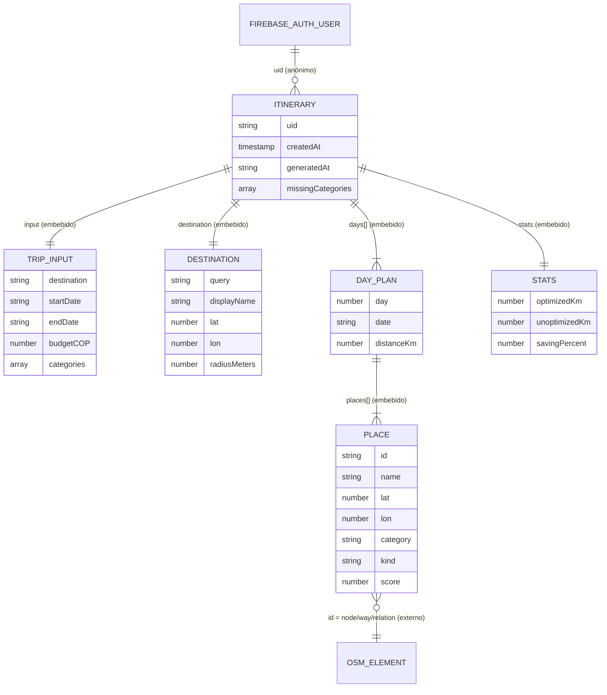

# 02 · Base de datos y modelo de datos de LOCUS

> Restricción respetada: no se creó, leyó ni modificó ningún documento. La única interacción con
> Firestore fue una petición REST **sin credenciales** de solo lectura para comprobar si la base existe
> (respuesta 403, sin datos).

---

## 1. Motor de base de datos

| Pregunta | Respuesta | Evidencia |
|---|---|---|
| ¿Qué motor está previsto? | **Cloud Firestore** (modo nativo, base `(default)`) | `firestore.rules`, `src/lib/firebase/client.ts` |
| ¿La app lo usa hoy? | **No.** Ninguna pantalla lee ni escribe en Firestore. | `saveItinerary()` no se importa en ningún componente; el SDK no está en el bundle. |
| ¿Existe la base en el proyecto `locus-bb57e`? | **Sí, con alta probabilidad.** | `GET …/databases/(default)/documents/itineraries` → `403 Missing or insufficient permissions` (una base inexistente responde distinto). |
| ¿Contiene datos? | **No verificable** sin acceso a la consola (y no se intentó leer). Como la app nunca escribe, lo esperable es que esté vacía, salvo pruebas manuales. | — |
| ¿Realtime Database? | No existe (`locus-bb57e-default-rtdb` → 404). | — |
| ¿Otra base de datos (SQL, etc.)? | No. Hay un servidor MCP `postgres` configurado en el entorno del analista, pero falló al conectar y **no tiene relación con el repositorio** (ningún archivo menciona PostgreSQL). | — |
| ¿Índices compuestos? | No hay `firestore.indexes.json` ni sección `indexes` en `firebase.json`. | — |

### ¿Dónde viven realmente los datos hoy?

| Dato | Dónde se guarda | Persistencia |
|---|---|---|
| Destinos destacados (8), con coordenadas, altitud, eslogan y 5 "lugares para visitar" c/u | `src/lib/featuredDestinations.ts` (código) | Estático, se publica con la app |
| 300 municipios de Colombia (id OSM, nombre, lat/lon, tipo, altitud, popularidad) | `src/data/colombiaTowns.json` (generado por `npm run data:towns` el 2026-10-14) | Estático; se descarga como chunk aparte (33 kB) al primer uso |
| Categorías de actividad y su traducción a etiquetas OSM | `src/lib/itinerary/categories.ts` | Estático |
| Climas por altitud (pisos térmicos) | `src/lib/itinerary/suggestDestination.ts` (`CLIMATES`) | Estático |
| Fotos | `public/images/**` | Estático (11 MB) |
| Viaje del usuario (destino, fechas, presupuesto, viajeros, habitaciones, modo) | Memoria de React (`TripFlowProvider`) | **Se pierde al recargar** |
| Respuestas de Overpass | `sessionStorage` (`locus:overpass:v1:<hash>`, TTL 24 h) | Mientras viva la pestaña |
| Servidores Overpass caídos | `sessionStorage` (`locus:overpass:failures`, 5 min) | Mientras viva la pestaña |
| Tema claro/oscuro | `localStorage` (`locus-theme`) | Permanente en ese navegador |

---

## 2. Colecciones diseñadas

| Colección | Propósito | Campos principales | Relaciones | Módulos que la utilizan |
|---|---|---|---|---|
| `itineraries` | Guardar un itinerario generado, ligado a la sesión anónima que lo creó | `uid`, `createdAt`, `input{…}`, `destination{…}`, `days[]{…}`, `missingCategories[]`, `stats{…}`, `generatedAt` | `uid` → usuario de Firebase Auth (no hay colección `users`) | Solo `src/lib/firebase/itineraries.ts` (`saveItinerary`). **Ningún módulo de UI la usa.** |

No hay subcolecciones. Las reglas mencionan que existen colecciones `leads` y `stats` en **otro**
proyecto Firebase (`locus-landing`, de la landing page), fuera del alcance de este repositorio.

### 2.1 Estructura del documento `itineraries/{autoId}`

Derivada del tipo `Itinerary` (`src/types/itinerary.ts`) más los campos que agrega `saveItinerary()`:

| Campo | Tipo Firestore | Origen | Notas |
|---|---|---|---|
| `uid` | string | `auth.currentUser.uid` (anónimo) | Única base de la autorización. |
| `createdAt` | timestamp | `serverTimestamp()` | Hora del servidor. |
| `generatedAt` | string (ISO 8601) | Cliente | Duplica `createdAt` con hora del cliente. |
| `input.destination` | string | Texto del usuario | |
| `input.startDate` / `input.endDate` | string `AAAA-MM-DD` | Formulario | Fechas como texto, no `timestamp`. |
| `input.budgetCOP` | number | Formulario | No se usa para filtrar nada. |
| `input.categories` | array<string> | `playa`, `cultura`, `gastronomia`, `aventura`, `vidaNocturna`, `compras` | |
| `destination` | map `{query, displayName, lat, lon, radiusMeters}` | Nominatim / lista local / destacado | Coordenadas como `number`, no `GeoPoint`. |
| `days` | array<map> `{day, date, distanceKm, places[]}` | Motor | Datos embebidos. |
| `days[].places[]` | array<map> `{id ("node/123"), name, lat, lon, category, kind, score}` | Overpass | Copia desnormalizada de OSM; `id` permite volver a OSM. |
| `missingCategories` | array<string> | Motor | |
| `stats` | map `{optimizedKm, unoptimizedKm, savingPercent}` | Motor | |

Tamaño estimado: un viaje de 14 días × 4 actividades = 56 lugares ≈ 10–15 kB por documento; muy por
debajo del límite de 1 MiB.



### 2.2 Consultas y operaciones

| Operación | Dónde | Tipo | Estado |
|---|---|---|---|
| `addDoc(collection(db,'itineraries'), {...})` | `itineraries.ts:11` | Escritura (create) | Implementada, **sin uso** |
| Listar itinerarios del usuario | — | — | **No existe** (requeriría `where('uid','==',uid)`; sin ese filtro las reglas rechazarían la consulta) |
| Leer / borrar un itinerario | — | — | **No existe** en código (las reglas lo permitirían al dueño) |
| Paginación, transacciones, batch, listeners en tiempo real | — | — | **No existen** |

---

## 3. Entidades del dominio turístico: ¿existen?

| Entidad | ¿Existe? | Cómo se representa hoy |
|---|---|---|
| Usuarios | Solo diseñada | `uid` anónimo de Firebase Auth, sin colección `users`. No conectado. |
| Perfiles | No | — |
| Anfitriones | No | — |
| Hospedajes | No | — |
| Habitaciones | Solo como número | Contador "Habitaciones" en el Paso 1 (`TripDetails.rooms`, 1…viajeros). No hay inventario. |
| Fotografías | Estáticas | Archivos JPG en `public/images` + créditos en `CREDITOS.md`. |
| Disponibilidad | No | — |
| Reservas | No | — |
| Calendarios | Solo inputs de fecha | `startDate`/`endDate` como texto ISO. |
| Tarifas | No | Solo "presupuesto total" del viajero (no precios de oferta). |
| Ubicaciones | Sí (en memoria) | `GeoPoint {lat, lon}` y `Destination` (con `radiusMeters`). |
| Destinos | Sí (estáticos + externos) | 8 destacados en código, 300 municipios en JSON, y cualquier lugar de Colombia vía Nominatim. |
| Actividades | Sí (como categorías) | 6 `CategoryId` mapeados a etiquetas OSM. No hay "actividades" como oferta con precio/horario. |
| Planes turísticos / itinerarios | Motor implementado, no en UI | Tipo `Itinerary`; colección `itineraries` diseñada. |
| Lugares de interés | Sí (dos fuentes) | (a) 40 "lugares para visitar" curados con foto (solo decorativos en la portada); (b) `Place` de Overpass en el motor (no visible en UI). |
| Reseñas / calificaciones | No | Existe un `score` heurístico de relevancia (Wikipedia +3, web +1, horario +1). |
| Favoritos | No | — |
| Pagos | No | — |
| Notificaciones | No | — |
| Conversaciones / mensajería | No | — |
| Historial de actividad | No | — |

---

## 4. Reglas de seguridad

### 4.1 Firestore (`firestore.rules`)

```
match /itineraries/{itineraryId} {
  allow create: if request.auth != null && request.resource.data.uid == request.auth.uid;
  allow read, delete: if request.auth != null && resource.data.uid == request.auth.uid;
  allow update: if false;
}
// Cualquier otra colección: cerrada por defecto.
```

**Lo que está bien**

- Denegación por defecto para todo lo demás.
- Nadie puede leer, borrar ni reescribir itinerarios de otro `uid`.
- `update: false` hace los documentos inmutables (evita manipulación posterior).
- Coherente con lo observado: lectura sin credenciales → 403.

**Riesgos encontrados**

| # | Riesgo | Criticidad | Detalle |
|---|---|---|---|
| R1 | **Sin validación de esquema ni de tamaño en `create`** | Alta (latente) | Solo se comprueba `uid`. Un cliente puede guardar cualquier estructura, campos extra, tipos incorrectos o documentos de hasta 1 MiB. Toda la validación existe solo en el frontend (y el frontend ni siquiera escribe). |
| R2 | **Escritura ilimitada por cualquier usuario anónimo** | Alta (latente, depende de la consola) | La configuración web es pública; si el proveedor "Anónimo" está activo y las reglas desplegadas son estas, cualquiera puede crear identidades anónimas y documentos sin límite vía SDK o REST, sin pasar por la app. Sin App Check ni cuotas, esto se traduce en costos y basura. Estado de Auth: **no verificable**. |
| R3 | `createdAt` no se valida contra `request.time` | Media | Un cliente puede falsear la fecha de creación. |
| R4 | Identidad anónima frágil | Media (funcional) | Si el usuario borra datos del navegador o cambia de dispositivo, pierde acceso a sus itinerarios para siempre; no hay vinculación con una cuenta real. |
| R5 | Reglas desplegadas desconocidas | — | No se pudo confirmar que lo publicado coincide con el archivo (requiere consola o CLI). |

### 4.2 Realtime Database y Storage

No existen en el proyecto (ver doc 01) y no hay archivos de reglas (`database.rules.json`,
`storage.rules`). Si se habilitan en el futuro, deben nacer con reglas cerradas.

### 4.3 ¿Validaciones solo en frontend?

Sí. `validateTripDetails()` (fechas, presupuesto ≤ 1.000 millones COP, destino ≥ 2 caracteres,
viaje ≤ 14 días) y `tripDates()` del motor corren en el navegador. Ninguna regla del servidor las
replica.

---

## 5. Inconsistencias, redundancias y oportunidades

1. **El documento no guarda todo el viaje.** `Itinerary.input` (tipo `TripInput`) no incluye
   `travelers`, `rooms` ni `mode` de `TripDetails`; al conectar el guardado se perderían esos datos.
2. **Dos modelos de "destino de entrada".** El flujo resuelve un `Destination` con coordenadas (de
   tarjeta, lista local, Modo B o Nominatim), pero `generateItinerary()` recibe un `TripInput` con
   `destination: string` y **vuelve a geocodificar** con Nominatim. Esto desperdicia la resolución
   previa, puede dar otro resultado y rompe el Modo B (el nombre de un pueblo sugerido puede ser
   ambiguo). Requiere ajustar la firma antes de construir el Paso 3.
3. **Fechas duplicadas** (`generatedAt` string + `createdAt` timestamp) y fechas de viaje como texto:
   simple, pero impide consultas por rango de fechas con tipos nativos.
4. **Coordenadas como dos `number`**: suficiente hoy; para consultas geográficas futuras convendría
   un geohash o `GeoPoint`.
5. **Lugares desnormalizados (copia de OSM)**: adecuado para un itinerario "foto en el tiempo", pero
   no habrá catálogo propio de lugares/actividades ni forma de enriquecerlos (fotos, precios, reseñas).
6. **No hay colección de usuarios** ni de catálogo (destinos, hospedajes, experiencias): toda la
   oferta es estática o de OSM.
7. **Índices**: cuando exista "mis itinerarios" ordenados por fecha (`where uid` + `orderBy createdAt`)
   hará falta un índice compuesto y su archivo versionado.

> Las propuestas de modelo para hospedajes, reservas y pagos se tratan como decisiones de
> arquitectura en `07_ESTADO_ACTUAL_Y_ROADMAP.md`.
