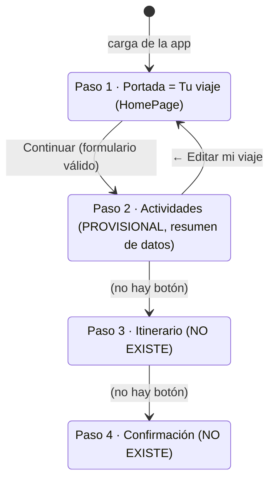

# 03 · Módulos y funcionalidades de LOCUS

> Recorrido hecho ejecutando el build de producción (`vite preview`) en el navegador, en escritorio
> (1366×850), tablet (768×1024) y móvil (375×812), y contrastado con el código.
> Leyenda de estados: **Operativo** · **Parcial** · **Solo interfaz** · **Simulado/estático** ·
> **No implementado** · **No verificable**.

---

## 1. Mapa de pantallas

La app tiene **una sola página** y un flujo de 4 pasos, de los cuales solo existen 2 pantallas:

No hay menú de navegación, páginas de cuenta, perfil, favoritos, reservas, administración, ayuda,
términos ni privacidad. El encabezado solo contiene el logotipo y el botón de tema.

---

## 2. Inventario de módulos

### 2.1 Encabezado y marco general

| Aspecto | Detalle |
|---|---|
| Objetivo | Identidad y preferencia de tema. |
| Ve el usuario | Logotipo textual "Locus." (punto en teal) y botón luna/sol. Enlace "Saltar al contenido" al tabular. Pie con atribución a OpenStreetMap. |
| Acciones | Alternar claro/oscuro (persiste en `localStorage`). |
| Componentes | `App`, `Header`, `ThemeToggle`; script inline en `index.html` aplica el tema antes de pintar. |
| Datos / servicios | Ninguno externo. |
| Estado | **Operativo.** El logotipo no es enlace (no lleva al inicio). |

### 2.2 Hero + barra de búsqueda (Paso 1, Modo A "Ya sé a dónde ir")

| Aspecto | Detalle |
|---|---|
| Objetivo | Que el usuario escriba su destino en Colombia. |
| Ve el usuario | Foto a pantalla completa (paisaje con palmas de cera), titular "Planea tu viaje por Colombia", barra "¿A dónde quieres ir?" y botón coral "Sugiéreme un lugar". |
| Acciones | Escribir → se despliega el panel del formulario y aparece un listado de sugerencias (hasta 6) navegable con flechas/Enter/Escape. Elegir una sugerencia fija el destino con coordenadas conocidas. |
| Componentes | `HomePage`, `SearchBar` (combobox WAI-ARIA), hook `useDestinationOptions`. |
| Información | Destinos destacados (código) + 300 municipios (`colombiaTowns.json`, carga diferida). **No consulta Nominatim al escribir** (lo prohíbe su política). |
| Resultado | Verificado: "med" → "Medellín · Antioquia, Colombia". |
| Estado | **Operativo.** Limitación: solo sugiere los 300 municipios más poblados/populares; otros (ej. Barichara) se resuelven al pulsar "Continuar". |

### 2.3 Panel "Cuéntanos tu viaje" (formulario del Paso 1)

| Aspecto | Detalle |
|---|---|
| Objetivo | Capturar fechas, viajeros, habitaciones y presupuesto. |
| Ve el usuario | Fechas de salida/regreso (`input type=date`), contadores de viajeros (1–20) y habitaciones (1–viajeros), presupuesto en COP con separador de miles y ayuda "≈ $625.000 por día · 4 días de viaje". Botón "Continuar →". |
| Acciones | Llenar y continuar; cerrar con ✕ o Escape; cambiar a Modo B ("¿No sabes a dónde ir?"). |
| Componentes | `TripDetailsPanel`, `FormField`, `Counter`, hook `useTripDetailsForm`, `validateTripDetails`, `resolveDestination`. |
| Validaciones (cliente) | Destino ≥ 2 caracteres; salida no pasada; regreso ≥ salida; viaje ≤ 14 días; presupuesto > 0 y ≤ 1.000.000.000. Errores visibles solo tras el primer intento; el foco va al primer campo con error. |
| Resolución del destino | 1) coordenadas ya conocidas (tarjeta o sugerencia) → 2) coincidencia con un destacado → 3) **Nominatim** (`countrycodes=co`) → 4) si Nominatim falla por servicio, la lista local de pueblos. |
| Resultado | Guarda `TripDetails` en el estado global y pasa al Paso 2. Verificado con Medellín (sin red) y Barichara (vía Nominatim, `displayName` "Barichara, Guanentá, Santander…", radio 8 km). |
| Estado | **Operativo** para capturar datos. Presupuesto, viajeros y habitaciones **no se usan después** en ningún cálculo. |

### 2.4 Modo B "Sugiéreme un destino"

| Aspecto | Detalle |
|---|---|
| Objetivo | Recomendar 3 municipios según clima y actividades. |
| Ve el usuario | Chips de clima (Frío 12–17 °C, Templado 17–24 °C, Cálido > 24 °C), chips de actividades (6, múltiple), botón "Buscar destinos", barra de progreso con "Cancelar", y 3 tarjetas-radio con altitud, clima y ✓/✗ por actividad. |
| Componentes | `DestinationSuggester`, `ChipGroup`, `choiceOptions`, `suggestDestination()`, `browserClient.suggestionDeps`. |
| Algoritmo | Top-200 municipios por popularidad → filtro por piso térmico (altitud) → primeros 15 del clima → **una** consulta Overpass `out count` para saber qué categorías hay a ≤ 7 km de cada uno → ranking por nº de categorías y popularidad → top 3. |
| Servicios | Lista local (sin red), Overpass (máx. 2 intentos × 2,5 s), Open-Elevation solo si falta altitud (hoy nunca). |
| Resultado | Verificado (Cálido + Playa): Barranquilla, Cartagena de Indias, … con el aviso "no alcanzamos a confirmar las actividades: el servicio de mapas está ocupado" porque Overpass no respondió. |
| Estado | **Parcial / dependiente de terceros.** El algoritmo está completo y probado, pero la verificación de actividades depende de servidores públicos de Overpass que en la prueba no respondieron; el resultado degradado ordena solo por popularidad dentro del clima. |

### 2.5 "Viaja por Colombia" (tarjetas de destinos)

| Aspecto | Detalle |
|---|---|
| Objetivo | Inspirar y atajar la elección de destino. |
| Ve el usuario | 8 tarjetas con foto (Cartagena, Medellín, Bogotá, Villa de Leyva, San Andrés, Salento, Santa Marta, Guatapé), chip de clima calculado por altitud y eslogan. Al pasar el mouse (o en táctil, al estar visibles) rotan 5 "lugares para visitar" con foto y nombre cada 2,2 s. |
| Acciones | Clic → Modo A con el destino y coordenadas puestos; foco en "Fecha de salida". |
| Componentes | `DestinationCards`, `PhotoCard`, `PhotoChip`, `featuredDestinations.ts`. |
| Información | 100 % estática y curada a mano (40 lugares con foto de Wikimedia Commons). |
| Estado | **Operativo como atajo; contenido estático.** Los "lugares para visitar" son **solo decorativos**: no tienen detalle, no son clicables y no alimentan ningún itinerario. Móvil: carrusel horizontal con snap; tablet: 2 columnas; escritorio: 3 columnas con la primera a doble ancho. |

### 2.6 "¿Qué te gustaría hacer?" (tarjetas de actividades)

| Aspecto | Detalle |
|---|---|
| Objetivo | Entrar al Modo B a partir de una actividad. |
| Ve el usuario | Carrusel continuo (45 s por ciclo, hacia la derecha) de 6 tarjetas: Playa, Cultura, Gastronomía, Aventura, Vida nocturna, Compras. Se pausa con hover/foco. |
| Acciones | Clic → Modo B con esa actividad marcada; falta elegir clima y buscar. |
| Componentes | `ActivityCards`, `PhotoCard`. |
| Estado | **Operativo como atajo.** No existen páginas ni catálogo de actividades/experiencias. |

### 2.7 Paso 2 "¿Qué te gustaría hacer?" (provisional)

| Aspecto | Detalle |
|---|---|
| Objetivo declarado | Elegir categorías de actividades para el itinerario. |
| Lo que hay | `ActivitiesStepPlaceholder`: "Este paso está en construcción" + resumen de lo guardado (destino con coordenadas y radio, fechas y nº de días, presupuesto, viajeros/habitaciones, modo A/B, actividades) + botón "← Editar mi viaje". Barra de progreso de 4 pasos (`Stepper`). |
| Estado | **Solo interfaz / provisional.** Es un callejón sin salida para el usuario. |

### 2.8 Motor de itinerarios (sin pantalla)

| Aspecto | Detalle |
|---|---|
| Objetivo | Generar un plan día a día con lugares reales y ruta optimizada. |
| Implementación | `generateItinerary()`: geocodificar → Overpass (60 lugares por categoría) → selección round-robin entre categorías (4 por día) → vecino más cercano global → corte en días → vecino más cercano por día → estadísticas de ahorro vs. orden ingenuo. |
| Dónde se ejecuta hoy | Solo en la terminal: `npm run demo:engine`. Ningún componente lo llama. |
| Pruebas | 29 casos en `generateItinerary.test.ts` + 14 en `osm.test.ts`, con fixture de Cartagena. |
| Estado | **Implementado y probado, no conectado a la UI.** |

### 2.9 Persistencia de itinerarios (Firebase)

**Implementado parcialmente, no conectado** (ver docs 01 y 02).

### 2.10 Módulos de la visión de producto

| Módulo | Estado | Comentario |
|---|---|---|
| Hospedajes (búsqueda, detalle, fotos) | **No implementado** | Solo existe el contador de habitaciones. |
| Disponibilidad y calendario | **No implementado** | Solo inputs de fecha del viaje. |
| Reservas | **No implementado** | — |
| Pagos | **No implementado** | — |
| Registro / inicio de sesión / recuperación | **No implementado** | Auth anónima en código, no conectada. |
| Perfil de usuario | **No implementado** | — |
| Favoritos | **No implementado** | — |
| Reseñas y calificaciones | **No implementado** | — |
| Detalle de destino | **No implementado** | Las tarjetas solo llenan el formulario. |
| Detalle de actividad / experiencia | **No implementado** | — |
| Mapa interactivo | **No implementado** | No hay librería de mapas. |
| Panel de anfitriones / proveedores / administración | **No implementado** | — |
| Mensajería, notificaciones | **No implementado** | — |
| Información de viaje (clima, transporte, consejos) | **No implementado** | Solo el chip de clima por altitud. |

---

## 3. Componentes reutilizables

| Componente | Reutilizable | Uso actual | Comentario |
|---|---|---|---|
| `PhotoCard` / `PhotoChip` | Sí | Destinos y actividades | Tarjeta con foto, degradado, insignia y carrusel de lugares. Lógica de hover/visibilidad compleja dentro del componente. |
| `ChipGroup<T>` | Sí, genérico | Clima y actividades | Radios/checkbox nativos ocultos: accesible por defecto. Previsto para el Paso 2. |
| `FormField` + `inputClassName` | Sí | Fechas y presupuesto | Render-prop que inyecta `id`, `aria-invalid`, `aria-describedby`. |
| `Counter` | Sí | Viajeros, habitaciones | `−`/`+` con `<output aria-live>`. |
| `Stepper` | Sí | Paso 2 | Progreso de 4 pasos. |
| `SearchBar` | Específico | Hero | Combobox ARIA completo. |
| `TripDetailsPanel`, `DestinationSuggester` | Específicos | Paso 1 | Acoplados a `TripDetailsForm`. |
| `ThemeToggle`, `Header` | Específicos | Global | — |

No hay librería de componentes externa ni Storybook. Los iconos son SVG en línea (repetidos, p. ej.
el pin aparece en `SearchBar` y `PhotoCard`) y emojis (clima, actividades, contadores).

---

## 4. Servicios y utilidades

| Módulo | Responsabilidad |
|---|---|
| `lib/format.ts` | `formatCOP`, `formatThousands`, `parseBudget`, `todayISO`, `formatDate`, `countTripDays` (zona horaria controlada). |
| `lib/itinerary/geo.ts` | Distancia Haversine. |
| `lib/itinerary/throttle.ts` | Cola con intervalo mínimo entre tareas. |
| `lib/itinerary/overpassCache.ts` | Caché en `sessionStorage` con hash FNV-1a + memoria de servidores caídos. |
| `lib/itinerary/errors.ts` | Errores tipados y traducción a mensajes. |
| `lib/itinerary/osm.ts` | Construcción de URLs/consultas QL y parseo (puro). |
| `lib/itinerary/osmClient.ts` | `fetch` con timeout, reintento en otro servidor, throttle por servidor. |
| `lib/itinerary/elevationClient.ts` | Lotes de 100 puntos a Open-Elevation. |
| `lib/flow/*` | Estado del flujo, formulario, validación, resolución de destino, autocompletado. |
| `scripts/*` | Demos de CLI y regeneración del JSON de pueblos (Node, con `User-Agent` propio). |
