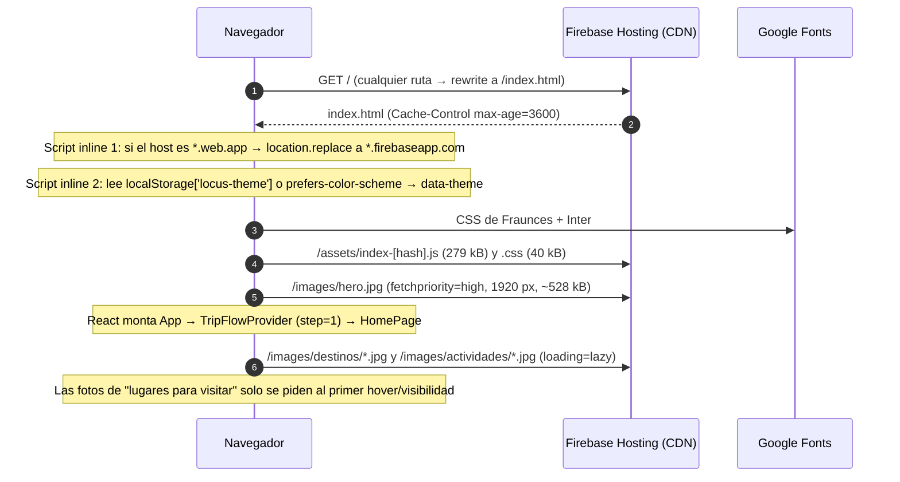
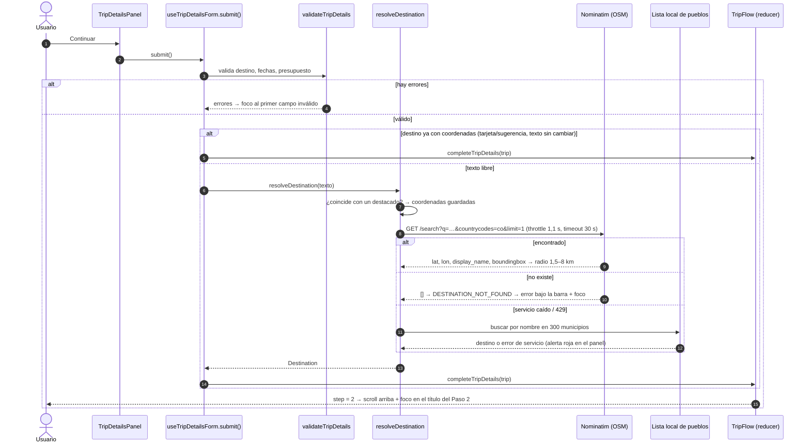
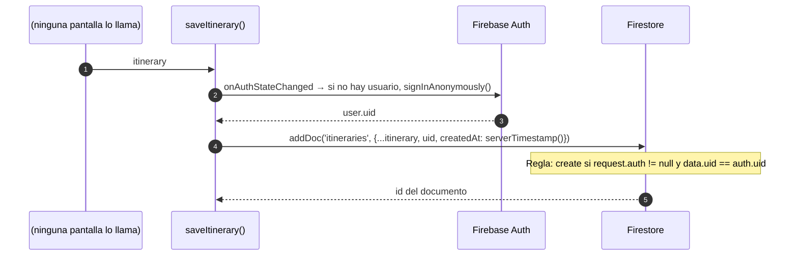

# 04 · Flujos de funcionamiento de LOCUS

> Cada flujo sigue la cadena **interacción → componente → función → servicio → autorización →
> lectura/escritura → respuesta → interfaz**, e indica **dónde se ejecuta** cada paso.
> Hoy **todo** se ejecuta en el navegador; los únicos servidores involucrados son Firebase Hosting
> (archivos estáticos) y APIs públicas de terceros. No hay autenticación ni autorización en ningún
> flujo activo.

---

## Resumen de flujos

| Flujo | ¿Existe? | Dónde corre | Servicios |
|---|---|---|---|
| Carga de la página principal | Sí | Hosting (CDN) + navegador | Firebase Hosting, Google Fonts |
| Autocompletado de destino | Sí | Navegador | Ninguno (datos locales) |
| Elegir tarjeta de destino / actividad | Sí | Navegador | Ninguno |
| Enviar Paso 1 (Modo A) | Sí | Navegador | Nominatim (solo si el destino no es conocido) |
| Sugerencia de destino (Modo B) | Sí | Navegador | Overpass (+ Open-Elevation si falta altitud) |
| Generar itinerario | Solo en CLI | Node (terminal) | Nominatim + Overpass |
| Guardar itinerario | Código sin uso | (sería navegador → Firebase) | Auth anónima + Firestore |
| Búsqueda de hospedajes, filtros, detalle, disponibilidad, reserva, pago | **No existen** | — | — |
| Registro, inicio de sesión, recuperación, perfil | **No existen** | — | — |
| Publicación/administración de hospedajes | **No existe** | — | — |
| Favoritos | **No existe** | — | — |

---

## 1. Carga de la página principal



- **Operaciones de datos:** ninguna. No se consulta Firestore ni ninguna API.
- **Respuesta en UI:** portada completa en un solo render; sin estados de carga.

## 2. Autocompletado de destino ("búsqueda")

```mermaid
sequenceDiagram
    autonumber
    actor U as Usuario
    participant SB as SearchBar
    participant HP as HomePage
    participant F as useTripDetailsForm
    participant O as useDestinationOptions
    participant J as colombiaTowns.json (chunk)
    U->>SB: escribe "med"
    SB->>HP: onChange("med")
    HP->>F: update('destination'); setMode('known'); expandir panel
    HP->>O: text = "med"
    alt primera vez con ≥ 2 letras
        O->>J: import() dinámico (33 kB desde Hosting)
        J-->>O: 300 municipios
    end
    O->>O: searchDestinations(): normaliza tildes, prefijo de nombre/palabra,<br/>destacados primero, quita duplicados (< 5 km de un destacado)
    O-->>SB: ≤ 6 opciones
    U->>SB: ↓ + Enter o clic
    SB->>HP: onSelectOption(opción)
    HP->>F: chooseDestination(destination con lat/lon) → foco en "Fecha de salida"
```

- **Dónde:** 100 % navegador; sin red salvo el chunk estático. Diseñado así para cumplir la política
  de Nominatim (prohíbe autocompletar por tecla).
- **Filtros/categorías:** no hay filtros de búsqueda (precio, tipo, etc.).

## 3. Envío del Paso 1 en Modo A (destino escrito)



- **Autenticación/autorización:** ninguna.
- **Escrituras:** solo en memoria (estado de React). Nada se guarda en servidor ni en almacenamiento.
- **Datos enviados a terceros:** el texto del destino a Nominatim (+ `Referer` con el dominio de la app).
  En producción **no** se envía el `email` de contacto (el build se hizo sin `VITE_NOMINATIM_EMAIL`).

## 4. Sugerencia de destino (Modo B)

```mermaid
sequenceDiagram
    autonumber
    actor U as Usuario
    participant D as DestinationSuggester
    participant SD as suggestDestination()
    participant J as colombiaTowns.json
    participant E as Open-Elevation
    participant OC as osmClient.queryOverpass
    participant C as sessionStorage (caché)
    participant OV as Overpass (3 réplicas)
    U->>D: elige clima + actividades → "Buscar destinos"
    D->>SD: (clima, categorías, deps, {signal, onProgress})
    SD->>J: loadTowns() (memoizado en módulo)
    SD->>SD: top-200 por popularidad
    opt alguno sin altitud (hoy: ninguno)
        SD->>E: GET lookup?locations=… (lotes de 100)
    end
    SD->>SD: filtra por piso térmico → primeros 15
    SD->>OC: checkActivities(15 centros, 7 km, categorías)
    OC->>C: ¿consulta idéntica en las últimas 24 h?
    alt en caché
        C-->>OC: respuesta
    else
        OC->>OV: POST intento 1 (servidor sano, timeout 2,5 s)
        alt falla (red, 429, 504, timeout)
            OC->>C: marcar servidor caído (5 min)
            OC->>OV: POST intento 2 en otra réplica (2,5 s)
        end
        OV-->>OC: 15×N conteos (out count)
        OC->>C: guardar respuesta
    end
    OC-->>SD: categorías encontradas por pueblo (o error)
    SD->>SD: ranking (nº categorías, popularidad) → top 3;<br/>si todo falló: activitiesUnverified = true
    SD-->>D: SuggestionResult
    D-->>U: 3 tarjetas-radio (+ aviso si no se verificó)
    U->>D: elige una → al "Continuar" se usa su Destination (radio 7 km) y sus categorías
```

- **Tiempo máximo garantizado de espera de Overpass:** ~5 s (2 × 2,5 s). Cancelable (`AbortController`).
- **Observado el 2026-11-12:** Overpass no respondió → resultado degradado con aviso. Los tres
  primeros fueron municipios cálidos populares, sin verificar playas.

## 5. Generación de itinerario (solo CLI)

```mermaid
flowchart LR
    A[TripInput<br/>destino texto, fechas, categorías] --> B[tripDates<br/>≤ 14 días]
    B --> C[geocodeDestination<br/>Nominatim]
    C --> D[searchPlaces<br/>Overpass: 60 por categoría,<br/>orden por score y cercanía]
    D --> E[selectPlaces<br/>round-robin, 4 por día]
    E --> F[optimizeRoute global<br/>vecino más cercano O n²]
    F --> G[splitEvenly<br/>un tramo por día]
    G --> H[optimizeRoute por día<br/>saliendo del centro]
    H --> I[computeStats<br/>km optimizados vs ingenuos]
    I --> J[Itinerary]
    J -. no conectado .-> K[(saveItinerary → Firestore)]
```



- Se ejecuta con `npm run demo:engine` en Node. **No hay pantalla que lo dispare.**
- Distancias en línea recta (Haversine), no por calles; no considera horarios, costos, duración de
  visitas, presupuesto ni transporte.

## 6. Guardado de itinerario (diseñado, no activo)



## 7. Flujos inexistentes que la visión del producto requiere

| Flujo | Estado | Qué faltaría (a alto nivel) |
|---|---|---|
| Búsqueda y filtros de hospedajes | No existe | Catálogo de hospedajes, índices, consultas paginadas. |
| Detalle de hospedaje, consulta de disponibilidad | No existe | Modelo de inventario y calendario. |
| Proceso de reserva | No existe | Lógica de servidor (transacciones, bloqueo de fechas, precio calculado en servidor). |
| Pagos | No existe | Pasarela + webhooks en servidor. |
| Registro, login, recuperación de cuenta, perfil | No existe | Proveedores de Auth (correo, Google…), vinculación de la cuenta anónima. |
| Publicación/administración de hospedajes | No existe | Roles (anfitrión/admin) con *custom claims* y reglas. |
| Exploración de actividades y lugares | Solo inspiración estática | Catálogo propio o vistas sobre OSM con detalle. |
| Favoritos | No existe | Subcolección por usuario. |

> **Advertencia para próximas etapas:** cualquier operación sensible (precio, disponibilidad,
> confirmación de reserva, pago) **no debe** ejecutarse solo en el navegador. Con la arquitectura
> actual (sin backend), un usuario podría manipular cualquier valor calculado en el cliente.
